<div align="center">

# Kinora

**A desktop TV, cinema, audio, and local media platform built with Rust, Tauri 2, React 19, and TypeScript.**

[Installation](#installation) · [Screenshots](#screenshots) · [Features](#features) · [Supported Sources](#supported-sources-and-integrations) · [Development](#development) · [Documentation](#documentation)


-1b2332?style=flat-square)

<br />

<a href="docs/images/kinora-home.png">
  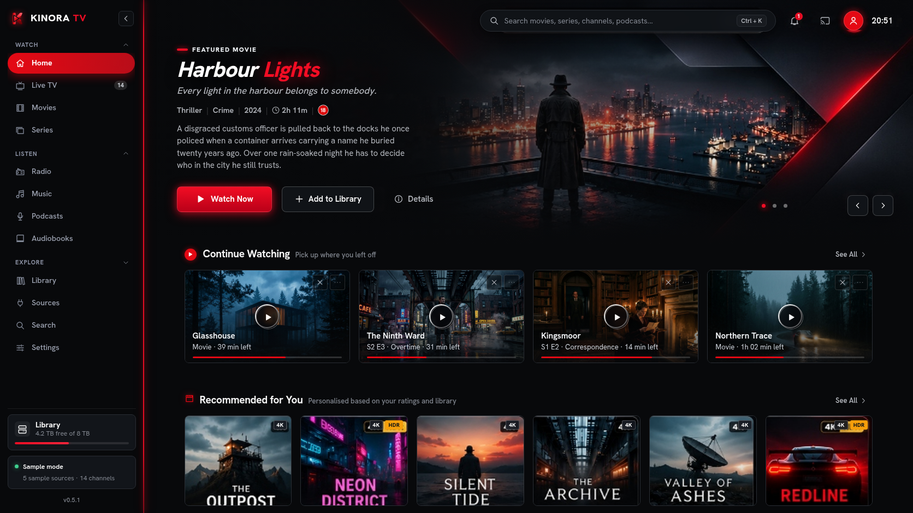
</a>

<sub>Captured directly from the native Kinora 0.6.0 Linux desktop application with real configured broadcast playlists and XMLTV programme guides.</sub>

</div>

---

## About Kinora

Kinora brings live television, programme guides, on-demand films and series, local media folders, internet radio, podcasts, and ebooks into one native desktop application.

Your playlists, guide schedules, preferences, and viewing history stay on your own machine. Network requests, stream proxying, XMLTV parsing, artwork caching, and encrypted backups run inside the Rust shell behind strict destination guards and a locked-down Content Security Policy. You can run Kinora standalone on one computer, or pair household desktop clients and phone browsers with the optional headless `kinora-server` binary on a Linux host, NAS, or Docker container.

Kinora does not host, bundle, or sell television channels or streams. You supply the playlists, guides, servers, or local folders you are authorised to access.

---

## Screenshots

Every screenshot below was captured from the native Kinora 0.6.0 application running against real configured sources. Select any image to view it at full resolution.

<table>
  <tr>
    <td width="50%" valign="top">
      <a href="docs/images/screenshots/live-tv-guide.png">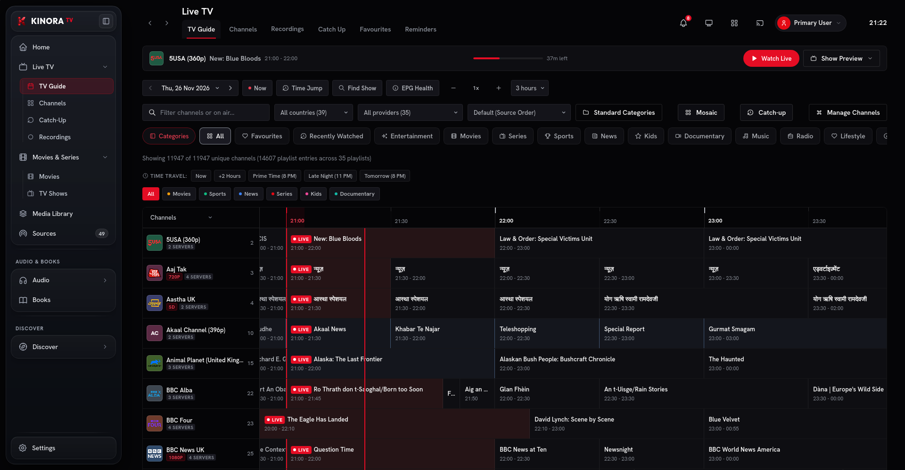</a>
      <br />
      <strong>Live TV Guide (EPG)</strong>: Virtualised schedule grid supporting 10,000+ channels, multi-tier XMLTV matching, time jump, and category filters.
    </td>
    <td width="50%" valign="top">
      <a href="docs/images/screenshots/live-tv-channels.png">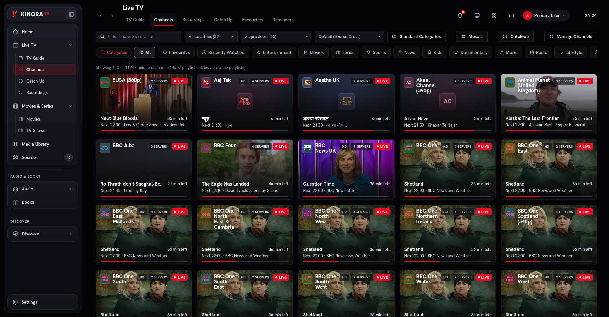</a>
      <br />
      <strong>Live TV Channels</strong>: Browse deduplicated channels by country, provider, or category with active programme artwork and server counts.
    </td>
  </tr>
  <tr>
    <td width="50%" valign="top">
      <a href="docs/images/screenshots/movies.png">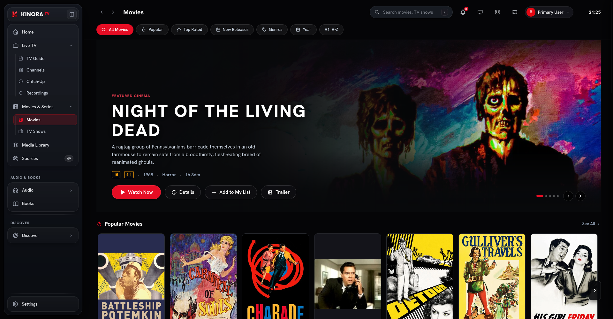</a>
      <br />
      <strong>Movies</strong>: Featured cinema hero, unobstructed 2:3 poster rails, genre browsing, and provider integration for on-demand films.
    </td>
    <td width="50%" valign="top">
      <a href="docs/images/screenshots/series-posters.png">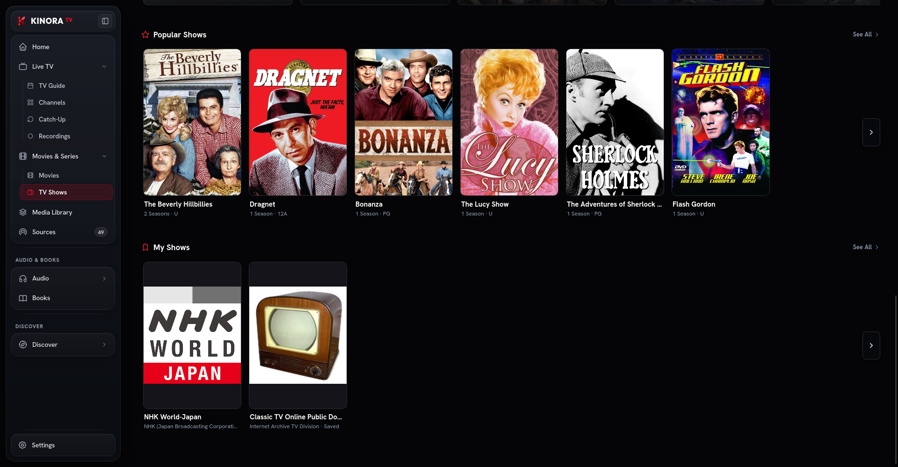</a>
      <br />
      <strong>TV Shows and Series</strong>: Top-weighted 2:3 series poster framing with captions placed below artwork, plus season and episode browsing.
    </td>
  </tr>
  <tr>
    <td width="50%" valign="top">
      <a href="docs/images/screenshots/movie-detail.png">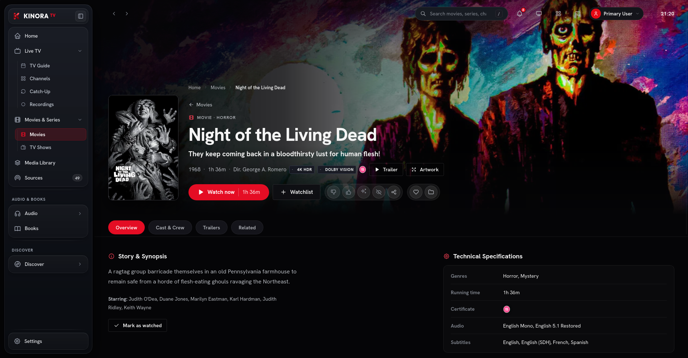</a>
      <br />
      <strong>Movie Detail</strong>: Full synopsis, cast, playback actions, technical specifications, watchlist toggle, and custom artwork inspection.
    </td>
    <td width="50%" valign="top">
      <a href="docs/images/screenshots/series-detail.png">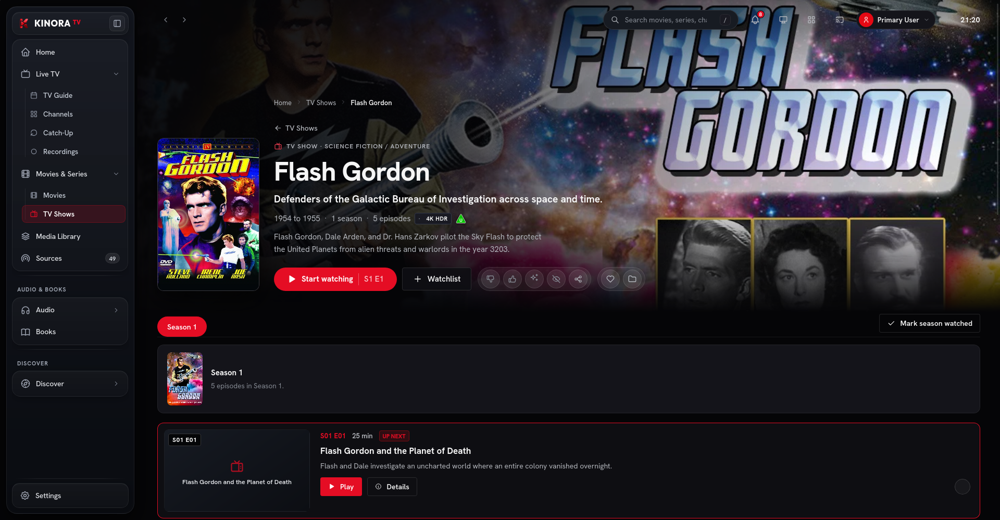</a>
      <br />
      <strong>Series Detail</strong>: Season selectors, episode progress tracking, and role-matched poster, backdrop, and episode artwork.
    </td>
  </tr>
  <tr>
    <td width="50%" valign="top">
      <a href="docs/images/screenshots/discover-genres.png">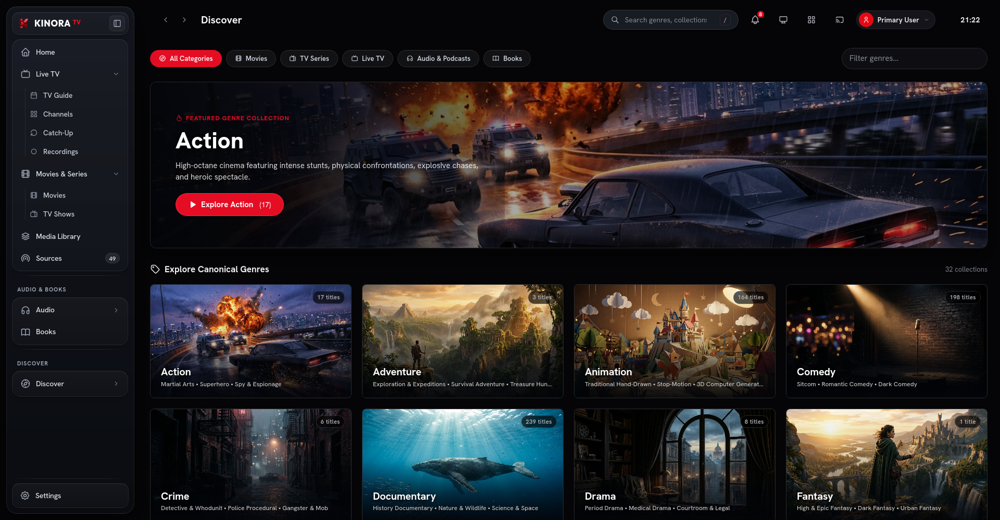</a>
      <br />
      <strong>Discover and Genres</strong>: Browse unified genre collections across films, series, live TV, audio, and books with customisable genre art.
    </td>
    <td width="50%" valign="top">
      <a href="docs/images/screenshots/media-library.png">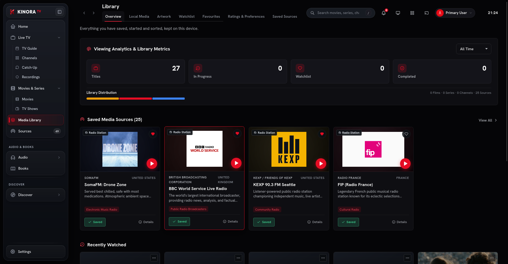</a>
      <br />
      <strong>Media Library</strong>: Local folders, saved media resources, watchlists, favourites, custom artwork management, and per-profile metrics.
    </td>
  </tr>
  <tr>
    <td width="50%" valign="top">
      <a href="docs/images/screenshots/audio-radio.png">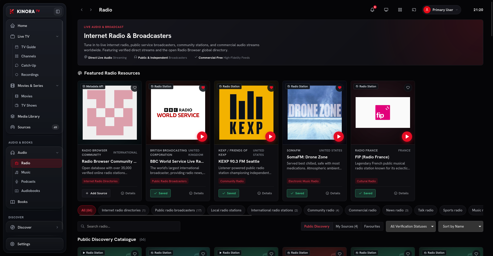</a>
      <br />
      <strong>Audio, Radio, and Podcasts</strong>: Live internet radio stations, RSS/Atom podcast subscriptions with episode resume, and a persistent audio bar.
    </td>
    <td width="50%" valign="top">
      <a href="docs/images/screenshots/tv-mode-home.png">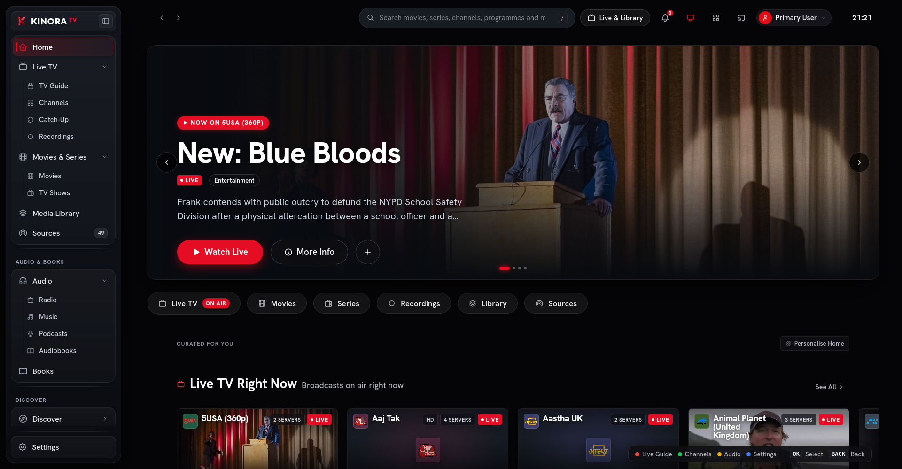</a>
      <br />
      <strong>10-Foot TV Mode</strong>: Scaled living-room interface with spatial D-pad/gamepad focus and a compact bottom-right remote legend clear of the sidebar.
    </td>
  </tr>
  <tr>
    <td width="50%" valign="top">
      <a href="docs/images/screenshots/settings.png">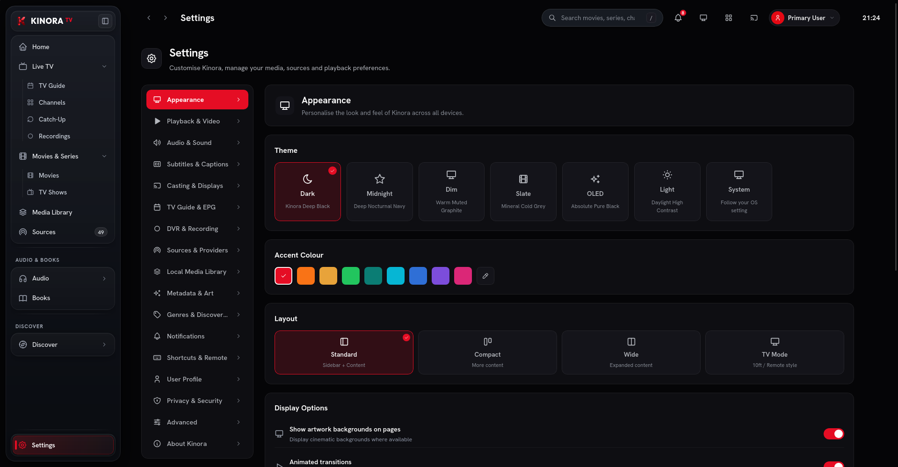</a>
      <br />
      <strong>Appearance and Settings</strong>: Six themes (Dark, Midnight, Dim, Slate, OLED, Light), custom contrast-checked accents, playback, EPG, backup, and updater controls.
    </td>
    <td width="50%" valign="top">
      <a href="docs/images/screenshots/sources.png">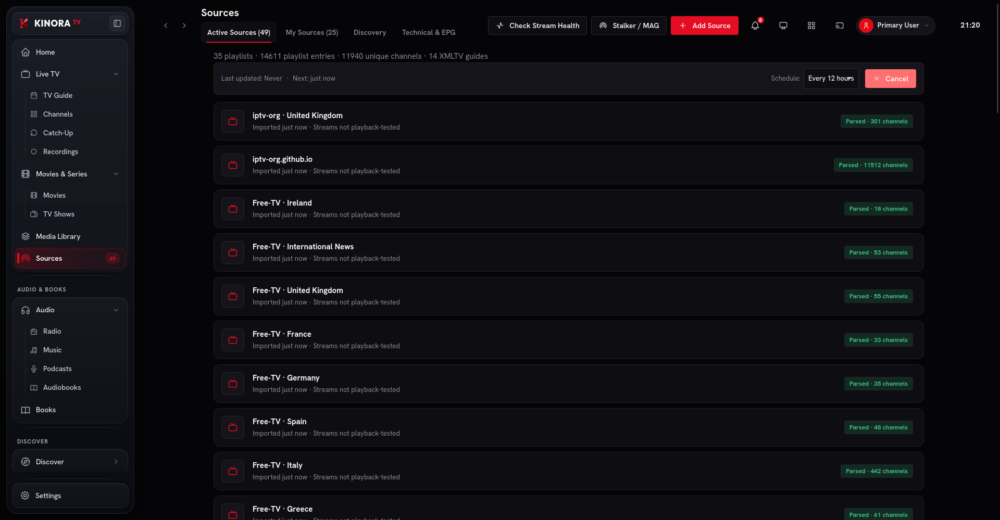</a>
      <br />
      <strong>Sources Management</strong>: Manage M3U playlists, XMLTV guides, refresh schedules, iptv-org Discovery, and provider connections in one view.
    </td>
  </tr>
</table>

---

## Features

- **Live TV and Virtualised EPG:** Browse 10,000+ channels smoothly with 2D row and time virtualisation, multi-tier XMLTV channel matching (exact ID, `@feed` fallback, loose country-verified key, and saved manual matching), custom channel bouquets, catch-up playback, and DVR series recording rules.
- **Movies and TV Series:** Unified catalogue views for Xtream Codes providers, guarded Jellyfin/Emby/Plex connections, local video folders, and open preservation archives, with cross-source deduplication, per-profile watch progress, and cast/technical metadata views.
- **Artwork and Metadata Pipeline:** Lazy guarded raster logo fetching, 5-stage artwork resolution with role validation (2:3 posters, 16:9 backdrops and episode stills, square/clean logos), aspect-aware framing so titles and subjects stay visible, and per-item custom artwork overrides.
- **Audio, Podcasts, and Reading:** Live internet radio directory, guarded RSS/Atom podcast subscriptions with resume and played state, persistent mini audio player bar, OPDS catalogue browsing, and a built-in EPUB, Markdown, HTML, plain text, and CSP-safe PDF.js canvas reader.
- **Persistent Playback and Codecs:** Native Rust `kstream` HLS stream proxy with memory-only 128-bit handles, persistent Picture-in-Picture dock while browsing, audio/subtitle track selection, sleep timer HUD, stream header profiles, and honest system codec diagnostics.
- **Desktop, 10-Foot TV Mode, and Remote Control:** Toggle between Desktop and TV Mode with `Ctrl+Shift+T` (`Cmd+Shift+T` on macOS), navigate with keyboard, D-pad, or gamepad, or pair any phone/tablet over LAN via 6-digit PIN or QR code to use the embedded 5-tab mobile web remote.
- **Standalone, Central Server, and Client Modes:** Run standalone on desktop, deploy the zero-GUI `kinora-server` binary (Linux, Raspberry Pi, systemd, or Docker) for always-on shared sources and bounded HTTP Range local streaming, and sync watchlists/progress across LAN clients via Server-Sent Events.
- **Encrypted Backup and Signed Updates:** Export and restore settings, sources, guides, bouquets, DVR rules, and reading progress in AES-256-GCM encrypted archives with SHA-256 verification and transactional rollback; receive ETag-cached GitHub Release update notifications with Minisign signature verification and offline What's New history.

---

## Supported Sources and Integrations

| Source / Integration | Status | Notes and Limitations |
|---|---|---|
| **M3U / M3U8 Playlists (URL or local file)** | Complete | Parsed in Rust (up to 25 MB / 50,000 channels), saved locally, refreshed at startup. HLS over HTTP(S) plays via `kstream`; raw MPEG-TS, RTMP, RTSP, UDP, and DRM streams are refused with an explicit message. |
| **XMLTV Guides (`.xml` / `.xml.gz` URL or file)** | Complete | Parsed with `quick-xml` (DTD loading and custom entities disabled; 64 MB download / 128 MB decompressed cap). Cached per guide for offline startup. |
| **iptv-org Public Discovery Catalogue** | Complete | Reads the fixed public `PLAYLISTS.md` index on demand when Discovery is opened; entries import as standard playlists only when chosen. |
| **Xtream Codes API Providers** | Complete | Live TV, VOD movies, series, and EPG via guarded native Rust commands; credentials never exposed in URLs or logs. |
| **Local Media Folders** | Complete | Scans local video, audio, and book directories with change detection and bounded Range streaming via `kinora-server`. |
| **Podcast RSS / Atom & OPDS Catalogues** | Complete | Fetched through Rust's guarded native fetcher with episode progress and book catalogue browsing. |
| **Jellyfin / Emby / Plex Servers** | Partial | Guarded native transport and library browsing implemented; full transcoding/server-side session control is not included. |
| **Stalker / MAG Portals** | Experimental | Basic portal connection and catalogue support exist; provider compatibility varies widely. |

---

## Installation

### Desktop Packages

Signed installers and checksums for `v0.6.0` are published on [GitHub Releases](https://github.com/millsydotdev/KinoraTV/releases/tag/v0.6.0).

| Platform | Available Formats | Requirements | Webview Engine |
|---|---|---|---|
| **Linux (x86_64)** | `.rpm`, `.deb`, `.AppImage` | WebKitGTK 4.1, GTK 3, OpenSSL 1.1/3.0 | WebKitGTK 2.44+ |
| **Windows (x64)** | `.exe` (NSIS), `.msi` (WiX) | Windows 10 (1809+) or Windows 11 | Microsoft Edge WebView2 |
| **macOS (Apple Silicon & Intel)** | `.dmg`, `.app.tar.gz` | macOS Catalina 10.15 or later | Apple WebKit (WKWebView) |

Every release includes `SHA256SUMS.txt`, Minisign `.sig` files, a CycloneDX SBOM (`kinora-sbom.json`), and `latest.json` for verified in-app updates.

#### Linux Video Codecs

Video decoding on Linux runs through WebKitGTK and GStreamer. To play H.264/AAC HLS streams, install your distribution's GStreamer plugins:

```bash
# Fedora
sudo dnf install -y gstreamer1-plugin-openh264 gstreamer1-plugins-good

# Ubuntu / Debian
sudo apt-get install -y gstreamer1.0-libav gstreamer1.0-plugins-good

# Arch Linux
sudo pacman -S gst-plugin-openh264 gst-plugins-good
```

You can verify available codecs inside the app under **Settings > Playback & Video > What this system can play**.

### Headless Kinora Server (Optional)

To run Kinora as an always-on LAN media server without GUI dependencies (for Docker, NAS, or Linux hosts), see [docs/SERVER-DEPLOYMENT.md](docs/SERVER-DEPLOYMENT.md).

```bash
docker compose up -d --build server
```

---

## Configuration and Setup

1. **Add Sources:** Open **Sources > + Add Source** to import an M3U playlist by HTTPS URL or local file, attach an XMLTV guide, connect an Xtream Codes provider, or browse **Sources > Discovery** for public `iptv-org` playlists.
2. **Add Local Media:** Open **Settings > Local Media Libraries** to add folders containing films, series, audio, or EPUB/PDF books.
3. **Switch Desktop and TV Mode:** Click the monitor/TV icon in the top header or press `Ctrl+Shift+T` (`Cmd+Shift+T` on macOS). Use `Ctrl+B` to collapse or expand the sidebar.
4. **Pair the Mobile Web Remote:** Open **Settings > Shortcuts & Remote** (or **Platform & Devices**), enable the local server, and scan the QR code or enter the 6-digit PIN from any phone or tablet on the same Wi-Fi network.
5. **Back Up Your Setup:** Use **Settings > Advanced > Backup & Migration** to export an AES-256-GCM encrypted backup file before switching machines.

For playback headers, EPG manual matching, and storage recovery, see [docs/TROUBLESHOOTING.md](docs/TROUBLESHOOTING.md).

---

## Platform, Architecture, and Security

```text
React 19 + TypeScript (src/)          Rust + Tauri 2 (src-tauri/)
  UI, routing, themes, state  ── IPC ──▶  window shell, guarded HTTP fetcher,
  built by Vite into dist/    ◀── JSON ──  M3U/XMLTV parsers, kstream HLS proxy,
                                           atomic 0600 stores, updater, LAN server
```

- **Strict IPC & Capability Boundary:** `src/lib/native.ts` is the sole bridge from React to Rust, validating every response. Commands are deny-by-default in `src-tauri/build.rs` and explicitly allow-listed in `src-tauri/capabilities/default.json`.
- **Direct Anti-SSRF Networking:** All remote playlist, guide, logo, and stream fetches live in `src-tauri/src/fetch.rs` with `no_proxy()` enforced, DNS resolution checks blocking loopback/private/CGNAT/multicast/reserved IPv4 and IPv6 addresses, per-redirect revalidation (max 5 hops), no `Referer`, bounded timeouts/byte limits, and host-only error messages that never log paths, queries, or tokens.
- **Memory-Only Stream Handles:** Upstream stream URLs are never sent to the webview DOM or written to disk. `open_stream` returns an opaque `kstream://localhost/<128-bit handle>` served by `src-tauri/src/stream.rs`, rewriting HLS manifests and cancelling in-flight requests on close or channel switch.
- **Strict Content Security Policy:** `tauri.conf.json` locks down script, font, and remote image origins (`connect-src kstream://localhost`, `media-src blob:`). Logos and artwork are fetched through guarded Rust commands and validated as raster bytes before rendering.
- **Local Storage and Residual Risk:** Sources and guides are stored atomically (`0700` directory, `0600` file) under `<app data>/sources/sources.json` (on Linux: `~/.local/share/io.github.millsydotdev.kinora/sources/`). Saved playlist or guide URLs may contain provider account tokens readable by your OS user; exclude that directory from untrusted cloud sync tools if needed. See [docs/PRIVACY.md](docs/PRIVACY.md) for full details.
- **Known Limitations:** Because `no_proxy()` and private-IP guards are mandatory in release builds, corporate proxy-only networks and LAN-only IPTV tuners are not supported by the public playlist fetcher. Non-HLS live streams and DRM-encrypted streams are refused rather than failing silently.

---

## Development

### Prerequisites

- **Node.js 22+** and npm 10+
- **Rust 1.90+** (`rustup default stable`, with `clippy` and `rustfmt`)
- **Platform build libraries:**
  - **Fedora:** `sudo dnf install webkit2gtk4.1-devel openssl-devel curl file libayatana-appindicator-gtk3-devel librsvg2-devel gtk3-devel libsoup3-devel javascriptcoregtk4.1-devel patchelf rpm-build`
  - **Ubuntu / Debian:** `sudo apt-get install libwebkit2gtk-4.1-dev libayatana-appindicator3-dev librsvg2-dev libssl-dev patchelf rpm build-essential curl`
  - **macOS / Windows:** See [Tauri 2 Prerequisites](https://v2.tauri.app/start/prerequisites/)

### Common Commands

```bash
npm install                  # Install frontend dependencies and Tauri CLI
npm run dev                  # Run React UI in a browser at http://localhost:5199
npm run tauri:dev            # Launch native desktop app in development mode
npm run tauri:dev:staging    # Launch isolated staging desktop app
npm run typecheck            # Run TypeScript compiler checks (tsc -b)
npm test                     # Run Vitest frontend test suite
npm run test:rust            # Run Rust unit and integration tests (cargo test)
bash scripts/ci-local.sh     # Run full CI parity suite (multi-TZ, clippy, fmt, audits)
npm run tauri:build          # Build native release binary and platform packages
```

For environment variables, Docker fixtures, and staging build workflows, see [DEVELOPMENT.md](DEVELOPMENT.md).

---

## Documentation

| Document | Purpose |
|---|---|
| [DEVELOPMENT.md](DEVELOPMENT.md) | Developer onboarding, prerequisites, environment setup, and local commands |
| [DOCKER.md](DOCKER.md) | Multi-stage Docker builds, mock IPTV/EPG fixtures, and Compose services |
| [DEVOPS.md](DEVOPS.md) | CI/CD workflows, GHCR images, supply-chain security, and release gates |
| [STAGING.md](STAGING.md) | Isolated staging identifiers, data directories, and staging builds |
| [docs/SERVER-DEPLOYMENT.md](docs/SERVER-DEPLOYMENT.md) | Deploying headless `kinora-server` via Docker, binary, or Linux `systemd` |
| [docs/TROUBLESHOOTING.md](docs/TROUBLESHOOTING.md) | Codec setup, stream headers, EPG matching, and storage recovery |
| [docs/PRIVACY.md](docs/PRIVACY.md) | Local-only data handling, credential boundaries, and residual risk notes |
| [docs/RELEASE-READINESS.md](docs/RELEASE-READINESS.md) | Verification matrix, tested vs untested cases, and performance measurements |
| [CHANGELOG.md](CHANGELOG.md) | Structured release history for Kinora |

---

## Contributing and Support

**Created and maintained by [millsydotdev](https://github.com/millsydotdev)** · Canonical repository: [github.com/millsydotdev/KinoraTV](https://github.com/millsydotdev/KinoraTV)

- **Contributing:** Read [CONTRIBUTING.md](CONTRIBUTING.md) before submitting changes.
- **Support and Bug Reports:** Follow [docs/SUPPORT.md](docs/SUPPORT.md) and always scrub private playlist URLs, tokens, or credentials before posting logs.
- **Security Vulnerabilities:** Follow responsible disclosure in [SECURITY.md](SECURITY.md).
- **Community Standards:** See [CODE_OF_CONDUCT.md](CODE_OF_CONDUCT.md).

---

## Licensing and Acknowledgements

Kinora is published under the **Kinora Proprietary Source-Available Licence - All Rights Reserved**. See [LICENSE](LICENSE) for the full licence terms.

This is **not** an OSI-approved open-source licence. Commercial use, public redistribution, unauthorised forks, and ingestion for AI/ML training are prohibited without prior written permission. For intellectual property and brand scope details, see [docs/legal/kinora-licensing-and-ip-protection.md](docs/legal/kinora-licensing-and-ip-protection.md).

Third-party runtime libraries and bundled fonts are documented with their full licence texts in [public/THIRD-PARTY-NOTICES.txt](public/THIRD-PARTY-NOTICES.txt). Shipped packages use permissive third-party dependencies (MIT, Apache-2.0, BSD-2-Clause, BSD-3-Clause, ISC, Zlib, Unicode-3.0, Unlicense), weak-copyleft MPL-2.0 Rust crates (source available per MPL-2.0 Section 3.2), and SIL OFL-1.1 web fonts, with no GPL/AGPL components statically linked and system WebKit and GStreamer decoders linked dynamically from the host OS. Public playlist discovery credits [iptv-org](https://github.com/iptv-org/iptv) (Unlicense).
