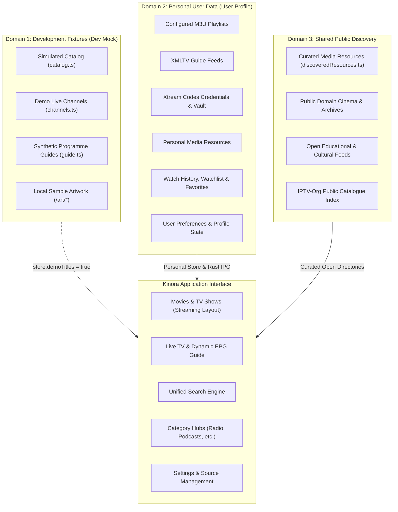
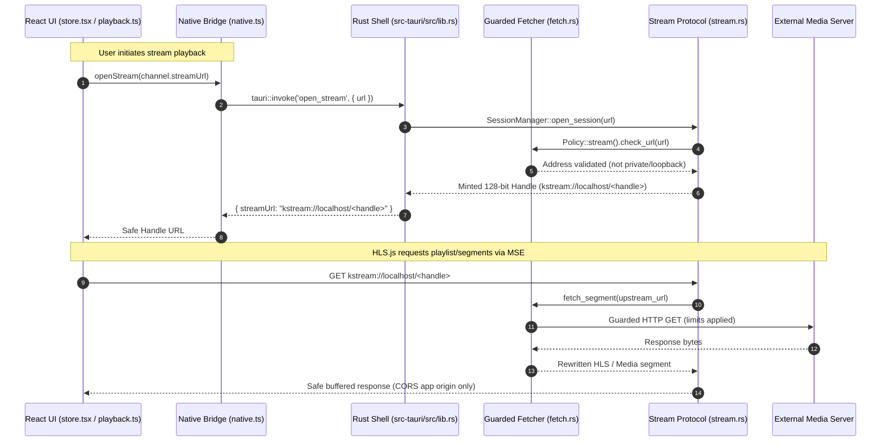

# Kinora Architecture and Data Flow

This document details the architectural boundaries, multi-domain data isolation models, runtime communication bridges, and network security guarantees governing the Kinora desktop application (React 19, TypeScript, Tauri 2, and Rust).

## 1. Domain Separation Architecture

Kinora operates across three strictly demarcated data domains. Data from one domain is never commingled, converted into, or silently written into another domain.

### 1.1 Domain 1: Development Fixtures (Dev Mock)
- Scope: In-memory static catalogs (`src/data/catalog.ts`), mock channels (`src/data/channels.ts`), synthetic guide generators (`src/data/guide.ts`), and local mock artwork (`/art/*.jpg`).
- Identification: Visually flagged across all detail sheets, search results, and resource cards with the `[Dev Fixture]` provenance pill.
- Boundary: Activated only when `store.demoTitles` is true (or when no personal sources have been imported and demo mode remains engaged). Fixture data is never written to `localStorage` user profile keys or the native `sources.json` store.

### 1.2 Domain 2: Personal User Data (User Sources)
- Scope: User-imported M3U playlists, remote XMLTV addresses, authenticated Xtream credentials, personal watch progress, watchlists, favourites, and profile-scoped settings.
- Identification: Flagged with `[Personal Source]`, `[Live TV]`, or `[Provider Catalogue]` provenance badges.
- Boundary: Persisted either natively in encrypted or restricted-permission filesystem stores (`sources.json` mode `0600`) or in profile-scoped localStorage namespaces (`kinora.personalMediaLibrary.v1.<profileId>`).

### 1.3 Domain 3: Shared Public Discovery
- Scope: Curated directory of legitimate public domain films, open educational broadcasts, national archives, and public service radio/podcast streams (`src/data/discoveredResources.ts`).
- Identification: Flagged with the `[Public Discovery]` provenance badge and explicit capability pills (e.g. `[Archive]`, `[Live Audio]`, `[Open Stream]`).
- Boundary: Stateless open directories available to both Dev Mock and User Sources modes. Users can explicitly bookmark or promote any public discovery resource into their personal library via the "Save to My Sources" action.

---

## 2. Component Communication and IPC Architecture

All communication between the React presentation tier and the native Rust backend passes through a single typed barrier: `src/lib/native.ts`.

### 2.1 Native Invocation Rules
1. `src/lib/native.ts` is the single source of truth for IPC types and response validation. When running outside Tauri (browser development or Vitest), calls return safe fallbacks or `null`.
2. Every native command is registered in `src-tauri/build.rs` and granted in `src-tauri/capabilities/default.json`.
3. Network calls never originate directly from React; all remote HTTP/HTTPS requests flow through Rust's `fetch.rs`.

---

## 3. Stream Routing and Security Subsystem

Upstream video and audio addresses may contain sensitive tokens, session keys, or user credentials. To prevent token leakage or cross-origin data theft:

1. **Address Redaction**: Upstream URLs are never rendered in plain text or saved to disk. The UI displays `streamDisplay` (redacted hostname) instead.
2. **KStream Custom Protocol**: The Rust backend serves video streams via `kstream://localhost/<handle>`. Each stream session generates an ephemeral 128-bit random handle.
3. **In-Flight Session Cancellation**: Only one stream session is active at a time. Opening a new channel immediately cancels all in-flight network requests from the prior session.
4. **HLS Manifest Rewriting**: `src-tauri/src/hls.rs` parses and rewrites master and media playlists so that variant streams, audio renditions, subtitles, and media segments are mapped to child handles. Unknown URI-bearing tags fail closed, and DRM-encrypted streams are refused.
5. **Strict Network Policy**: Reqwest proxies are permanently disabled (`no_proxy()`). The resolver rejects private IPv4/IPv6 ranges, loopback addresses, multicast blocks, and link-local destinations on every redirect hop.
