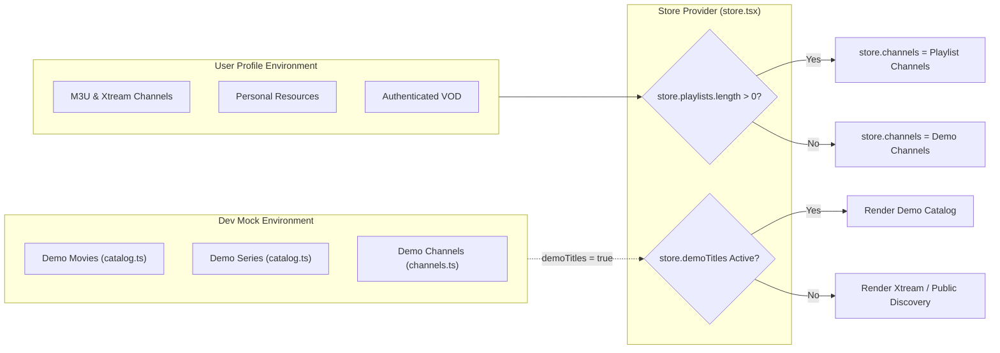

# Kinora Environment and Data Isolation Specification

This document details the environment isolation boundaries, profile namespacing protocols, native file permission rules, and leakage prevention mechanisms in Kinora.

## 1. Storage Namespacing and Profile Scoping

Kinora enforces strict multi-profile isolation. User-generated records, personal libraries, watch histories, and parental controls are partitioned by profile ID to guarantee zero cross-profile data leakage.

### 1.1 Local Storage Key Taxonomy

| Namespace Key | Scope | Content | Isolation Boundary |
|---|---|---|---|
| `kinora.library.v1` | Legacy / Global | Watch history, favourites, and playback progress | Migrated and superseded by profile-scoped stores |
| `kinora.prefs.v2` | Global / Active | Theme tokens, subtitle styling, time formats | Global UI preferences |
| `kinora.profiles.v1` | Global | Profile roster (ID, name, avatar, kids mode flag) | System-level account registry |
| `kinora.active_profile.v1` | Global | ID of the currently active user profile | Session tracking |
| `kinora.personalMediaLibrary.v1.<profileId>` | Profile Scoped | Saved media resources, personal audio/video feeds | Strict profile partition; wiped on profile deletion |
| `kinora.saved_searches.v1.<profileId>` | Profile Scoped | Search queries, filter parameters, and timestamps | Private search history per user |
| `kinora.parental_pin_secure.v1` | System Scoped | Salted SHA-256 hash (`kinora:<salt>:<hash>`) | Enforces 4-digit numeric PIN, lockouts, and salt protection |

### 1.2 Profile Lifecycle and Cascade Deletion
When a profile is removed in `src/screens/Profiles.tsx`, the store executes an atomic cascade purge:
1. Deletes `kinora.personalMediaLibrary.v1.<profileId>`.
2. Deletes `kinora.saved_searches.v1.<profileId>`.
3. Drops all references in active memory structures before switching to the primary default profile.

---

## 2. Dev Mock vs. User Sources Isolation

A critical design requirement is that Dev Mock content (fictional movies, series, episodes, and demo TV channels) must never pollute the genuine User Sources profile.

### 2.1 The "Never Both" Principle
`store.channels` enforces a strict exclusivity rule:
- If any real playlist exists (`store.playlists.length > 0`), `store.channels` contains **only** genuine playlist channels. Demo channels are completely evicted.
- If no playlists exist, demo channels are displayed as a baseline preview.
- At no point are demo channels merged with real user channels.

### 2.2 On-Demand Catalog Isolation
In Movies and TV Shows:
- When `store.demoTitles` is true: The UI displays the 5 demo films and 5 demo series from `catalog.ts`.
- When `store.demoTitles` is false: The UI displays genuine Xtream VOD catalogs. If no Xtream provider is connected, the UI seamlessly presents curated Public Discovery cinema archives without crashing, displaying blank pages, or leaking fictional demo records.

### 2.3 Out-of-Environment Route Protection
If a user follows a deep link or bookmark to a demo title (`/movies/low-orbit` or `/series/ninth-ward`) while running in User Sources mode, the application gracefully presents an informative `StateBlock` explaining that the requested title is a development fixture. It provides direct navigation buttons to return to the active catalog or configure new sources, preventing blank screen failures.

---

## 3. Native Filesystem Security (`sources.json`)

Saved sources, provider credentials, and hand matches are owned exclusively by Rust in `src-tauri/src/sources.rs`.

1. **Path and Permissions**: `<app data>/sources/sources.json`. The parent directory is created with mode `0700` (read/write/execute by owner only), and the file is maintained at mode `0600` (read/write by owner only).
2. **Atomic Writes**: Saves write to an adjacent temporary file before performing an atomic rename. This prevents data corruption during unexpected shutdowns or system failures.
3. **Restricted Payload**: `sources.json` stores source addresses and metadata only. Stream addresses, media segments, handles, session states, and cached raster logos are strictly excluded.
4. **Schema Versioning**: Version migrations are governed by `SCHEMA_VERSION = 2`. Damaged files are safely moved aside with a `.corrupt` extension rather than deleted, and newer unrecognised versions trigger a graceful read-only fallback mode.
